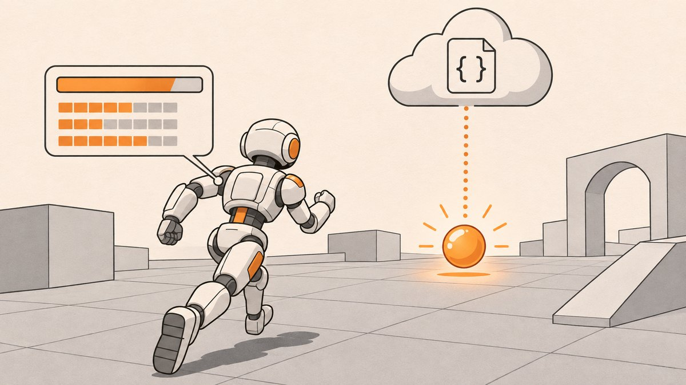

# Unity Pickup to JSON Sync

A Unity 3D demo where a third-person character picks up a sphere and that pickup sends a POST request to a mock JSON API.

## What it does

When the scene starts, player stats (name, health, personality, charm, behavior, management) are loaded from a mock REST endpoint and shown in a HUD. Walk the character into the sphere: it disappears, the Intellect stat on screen jumps to 3, and a POST request sends a new `Health` value to the server, whose reply is shown in the Health text.

It reuses the GET and POST scripts from [unity-json-get-post](https://github.com/MemeGamer/unity-json-get-post), and the data comes from the `db.json` in [unity-mock-player-data](https://github.com/MemeGamer/unity-mock-player-data).

## How it works

- **ThirdPersonBehaviour.cs** (in `Assets/Invector-3rdPersonController_LITE/Scripts/CharacterController/`) sits on the player. In `OnTriggerEnter` it checks for the `Ball` tag, finds the `ServerUpdate` GameObject, calls `PostMethod.PostData()`, destroys the ball, sets `intallect` to 3 and updates a TextMeshPro label. It also exposes `ethics`, `honesty` and `kindness` sliders (1 to 3) that are not used yet.
- **Assets/Script/PostMethod.cs** builds a `WWWForm` with `Health=110`, sends it with `UnityWebRequest.Post`, shows `Loading...`, and writes the returned `Health` into a UI `Text`. Here `PostData()` is public and only runs when called.
- **Assets/Script/Demo.cs** runs a GET in `Start`, parses the JSON into a `Data` struct with `JsonUtility`, and fills six UI `Text` fields. The image download from the GET-POST demo is commented out.
- Character movement and camera come from the Invector Third Person Controller LITE asset included in `Assets/`.

## Tech

- Unity 2020.3.25f1
- UGUI 1.0.0, TextMeshPro 3.0.6, Timeline 1.4.8
- Invector Third Person Controller LITE (Asset Store package, committed in `Assets/`)
- `UnityWebRequest`, `JsonUtility`

## Use it

1. Clone the repo and open it in Unity Hub with Unity 2020.3.25f1.
2. Open `Assets/Invector-3rdPersonController_LITE/Invector_BasicLocomotion.unity` (not `Assets/Scenes/SampleScene.unity`, which has none of the demo set up) and press Play.
3. Move with WASD and walk into the sphere to trigger the POST.
4. To build your own version: tag the pickup `Ball` with a trigger collider, put `PostMethod` on a GameObject named exactly `ServerUpdate`, add `ThirdPersonBehaviour` to the player and assign its `Intellect_txt`, and assign the UI `Text` fields on `Demo` and `PostMethod`.

## Scripts

| Script | Purpose |
| --- | --- |
| `Assets/Script/Demo.cs` | GET request that fills the stats HUD |
| `Assets/Script/PostMethod.cs` | POST request that sends a new `Health` value |
| `Assets/Invector-3rdPersonController_LITE/Scripts/CharacterController/ThirdPersonBehaviour.cs` | Detects the `Ball` pickup and triggers the POST |

## Notes

- Despite the repository name, the character is third person, not first person.
- `Library/` and `Temp/` were committed (about 8,000 generated files, roughly 115 MB of history). Unity regenerates them; they should be removed from the repo and added to a `.gitignore`. Some paths in `Library/PackageCache` are long enough to fail checkout on Windows unless `git config core.longpaths true` is set.
- The endpoint `https://my-json-server.typicode.com/MemeGamer/MockData/UnityData` still uses the old repo name `MockData`; the repo is now `unity-mock-player-data`. At the time of writing, My JSON Server returned errors for both names. It is also a fake REST API, so POSTs are not saved.
- The Invector LITE asset and its 17 MB trailer video are third-party Asset Store content redistributed in this repo.
- `isNetworkError` and `isHttpError` are deprecated in Unity 2020.2 and later and produce warnings.
